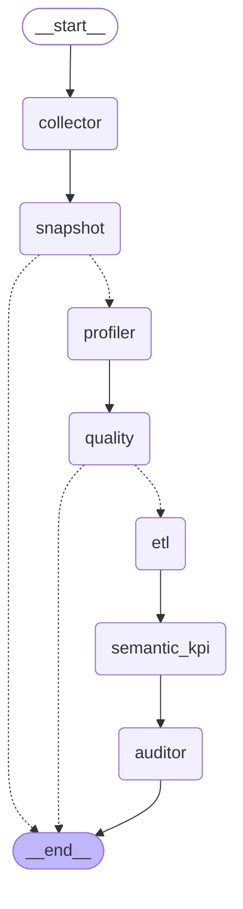
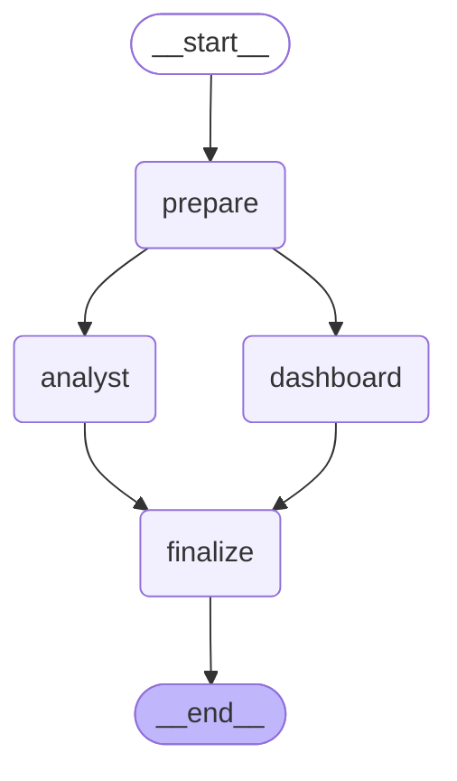
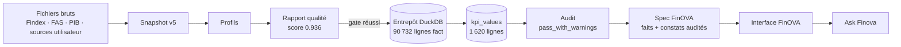

# Architecture multi-agents — FinOVA / BIFlow

- **Généré le** : 2026-11-05T18:36:18
- **Run audité (Route 1)** : `part_d_audit_report`
- **Snapshot** : `v5`
- **Version du catalogue KPI** : 1.7.0
- **Run Route 2 (spec publiée)** : `route2_20261104T125802503588`
- **Sources lues** : `config/config.yaml`, `outputs/reports/<run>/*.json`, `data/processed/warehouse.duckdb`, `graphes LangGraph (biflow.graph, biflow.route2_graph)`
- Document généré par `scripts/build_deliverables.py` : ne pas modifier à la main.

## Vue d'ensemble

Deux routes orchestrées par LangGraph, plus un assistant à la demande :

- **Route 1** (`python main.py run`) : 7 agents en séquence, de la collecte au verdict d'audit. Le snapshot publié ne change que si l'audit n'a aucun échec.
- **Route 2** (`run_route2`) : préparation des faits, puis 2 agents en parallèle (Analyst, Dashboard spec) et fusion dans le contrat FinOVA validé.
- **Ask Finova** (`POST /api/ask`) : questions de l'utilisateur sur la vue affichée, réponses fondées uniquement sur les faits de la spec.

## Agents

| Agent | Route | Rôle | Entrées | Sorties | Outils | LLM / déterministe |
|---|---|---|---|---|---|---|
| Collector | Route 1 | Collecte les sources officielles (Findex, FAS, PIB WDI) et les sources utilisateur confirmées ; calcule l'empreinte SHA-256 de chaque fichier. | config.yaml (sources), API Banque mondiale (PIB), fichiers statiques data/raw/ | fichiers bruts, empreintes, métadonnées de collecte | requests (API WDI / SDMX FMI optionnelle), hashlib, pandas | déterministe |
| Snapshot | Route 1 | Versionne les fichiers bruts (blobs dédupliqués par SHA-256) ; sans donnée nouvelle, le run s'arrête. | fichiers bruts et empreintes du Collector | data/snapshots/ (index.json, vN/manifest.json, blobs/) | SnapshotStore | déterministe |
| Profiler | Route 1 | Profile chaque source : dimensions, valeurs manquantes, types, colonnes de métadonnées, valeurs atypiques (IsolationForest). | fichiers du snapshot | outputs/profiles/ (profils JSON) | pandas, scikit-learn (IsolationForest) | déterministe |
| Quality | Route 1 | Contrôle qualité : score par source, gate (seuil configuré), anomalies classées par sévérité, diagnostics de plausibilité, exclusion des sources utilisateur non conformes. | fichiers du snapshot, profils | data/quality/quality_report.json et .md | pandas, règles de config.yaml (quality) | déterministe + LLM optionnel (plan de remédiation rédigé, sans effet sur le score ni le gate ; groq → gemini) |
| ETL | Route 1 | Harmonise les sources (codes pays ISO3, années, unités) et construit le modèle en étoile. | fichiers du snapshot ayant passé le gate | data/processed/warehouse.duckdb (fact, country_dim, indicator_dim, country_year, population), lineage.json | pandas, DuckDB, pycountry | déterministe |
| Semantic & KPI | Route 1 | Calcule chaque KPI du catalogue pour le pays focus et les pairs, sur chaque année valide ; attribue un statut de publication. | entrepôt (table fact), catalogue KPI | table kpi_values, kpi_values.parquet | KpiCalculator, catalogue config/kpi_catalog.v1.yaml | déterministe |
| Auditor (BI Auditor / XAI) | Route 1 | Vérification indépendante : recalcul depuis fact sans le code KPI, contrôles de cohérence et de traçabilité, verdict d'audit, explications par valeur ; décide la publication du snapshot. | kpi_values, fact, lineage, rapport qualité, index des snapshots | data/audit/audit_report.json et .md, table kpi_explanations | contrôles A1–A6, B1–B9, C1–C4 (biflow.tools.audit_checks) | déterministe + LLM optionnel (reformulation de quelques explications, rejetée si un nombre n'est pas justifié ; groq → gemini) |
| Analyst (FinOVA) | Route 2 | Écrit les constats et la carte XAI à partir des faits exportés ; tout nombre d'une phrase doit exister dans les faits (verify_numbers). | faits de la spec (analysis dataset) | constats par page, carte XAI | gabarits déterministes, verify_numbers | déterministe (narration LLM désactivée : analyst.narrate = false) |
| Dashboard spec | Route 2 | Construit le contrat FinOVA 2.0 validé (pages, métriques, graphiques, faits, avertissements) ; ne calcule aucun KPI et n'approuve aucune publication. | analysis dataset, entrepôt en lecture seule, référence statique | finova_spec.json, dashboard_app/public/data/finova.json, historique | DashboardSpec (pydantic), WarehouseReader | déterministe |
| Ask Finova | Interface | Répond aux questions de l'utilisateur sur la vue affichée ; lit les chiffres uniquement via des outils sur les faits ; chaque nombre de la réponse est contrôlé (grounding). | question, faits de la spec du pays et de l'année choisis | réponse et faits cités (POST /api/ask) | outils FactTools, audit_text.grounding, repli déterministe | déterministe + LLM optionnel (conversation avec outils sur les faits, nombres contrôlés ; groq → gemini) |

## Dernier run mesuré

Durées, statuts et appels LLM lus dans les rapports d'agent (`outputs/reports/<run_id>/<agent>.json`).

| Agent | Run | Statut | Durée | Sortie clé | Appels LLM mesurés |
|---|---|---|---|---|---|
| Collector | `user_delete_20261104T105203` | réussi | 0.12 s | 3 source(s) collectée(s) | 0 appel |
| Snapshot | `part_d_audit_report` | réussi | 0.11 s | snapshot v5 (rebuild) | 0 appel |
| Profiler | `part_d_audit_report` | réussi | 2.31 s | findex 8 577 × 36 ; fas 32 209 × 57 ; gdp 19 575 × 6 | 0 appel |
| Quality | `part_d_audit_report` | réussi | 1.20 s | score 0.936, gate réussi | 0 appel |
| ETL | `part_d_audit_report` | réussi | 2.21 s | 90 732 lignes fact, 263 pays | 0 appel |
| Semantic & KPI | `part_d_audit_report` | réussi | 5.55 s | 44 KPI, 1 620 lignes kpi_values (1 267 disponibles, 111 avec revue) | 0 appel |
| Auditor (BI Auditor / XAI) | `part_d_audit_report` | réussi | 4.53 s | verdict pass_with_warnings (17 réussis, 2 avertissements, 0 échecs) | 0 appel |
| Analyst (FinOVA) | `route2_20261104T125802503588` | réussi | 0.01 s | 17 constats sur 96 faits, carte XAI oui | 0 appel |
| Dashboard spec | `route2_20261104T125802503588` | réussi | 0.55 s | 6 pages, 96 faits, publication approved | 0 appel |
| Ask Finova | non disponible | à la demande | non disponible | réponses à la demande, nombres contrôlés contre les faits | non disponible |

- Collector : run courant reconstruit depuis le snapshot publié : dernier Collector exécuté.
- Ask Finova : à la demande (POST /api/ask), aucun rapport de run.

## Graphe LangGraph

Diagrammes exportés depuis les graphes compilés (`get_graph().draw_mermaid()`), pas dessinés à la main. Les flèches en pointillés sont des arêtes conditionnelles : `snapshot` termine le run sans donnée nouvelle, `quality` le termine si le gate échoue.

### Route 1

### Route 2

## Flux de données

| Étape | Mesure | Valeur |
|---|---|---|
| Entrepôt | lignes fact `fas` | 15 753 |
| Entrepôt | lignes fact `findex` | 64 328 |
| Entrepôt | lignes fact `gdp` | 10 651 |
| Entrepôt | pays | 263 |
| KPI | lignes kpi_values | 1 620 |
| KPI | indicateurs distincts | 44 |
| Audit | lignes auditées | 1 620 |

## Garde-fous

- Aucun agent ne modifie une valeur publiée ; l'Auditor décide seul de la publication du snapshot.
- Tout texte (constat, explication, réponse d'Ask Finova) ne peut citer qu'un nombre présent dans les faits audités ; sinon il est rejeté et remplacé par la version déterministe.
- Le LLM n'est jamais nécessaire : sans clé, chaque agent utilise son repli déterministe.
